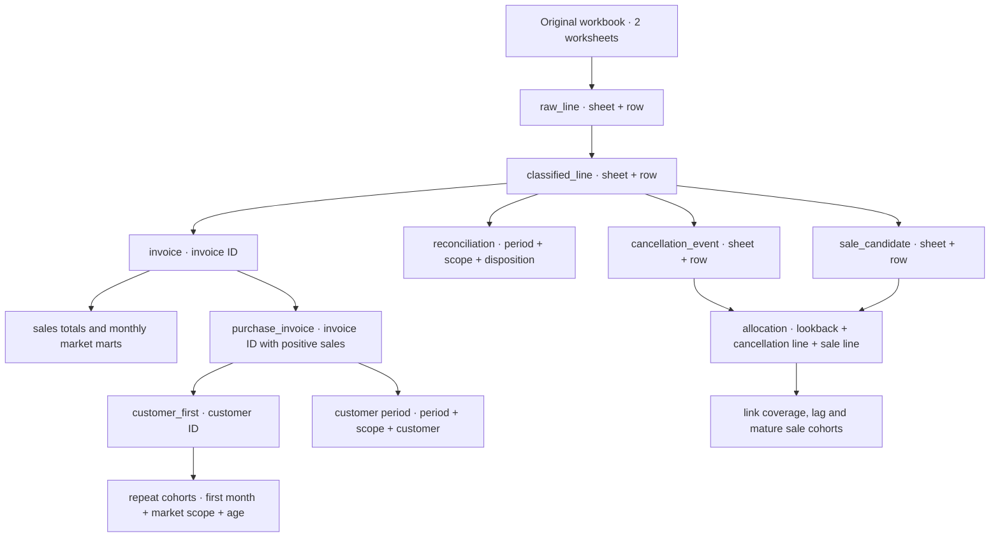

# Technical appendix

## Model and grain

The raw table is loaded from a checksum-pinned workbook and read by the model. Row lineage is the workbook sheet and physical row number, with the header at row 1. Each rebuild recreates the raw and model schema as a unit. Scope rollups are deliberate and overlapping. Query one scope at a time, or use disjoint country rows. For example, adding All markets, United Kingdom and Outside UK would count sales twice. The two comparison windows are disjoint, while All dates contains both. No dimension table is required.

## Data dictionary

| Source field | Raw SQL field and type | Analytical handling |
|---|---|---|
| Invoice | `invoice text` | `invoice_key` uppercased and trimmed. Six digits for standard invoices and C plus six digits for cancellation codes. Other prefixes stay visible. |
| StockCode | `stock_code text` | `product` uppercased and trimmed. Standard catalogue heuristic requires five digits with zero to two letters. Special codes are mapped before the heuristic. |
| Description | `description text`, nullable | Retained as entered. Conflict profiling compares trimmed uppercase nonblank descriptions by normalized stock code. |
| Quantity | `quantity integer` | Signed units. The extractor verifies all source quantities are integral. |
| InvoiceDate | `invoice_at timestamp`, `excel_date_serial numeric` | Naive timestamp reconstructed to the observed precision. Earliest line time is used at invoice grain, actual line times for linkage. |
| Price | `source_price numeric` | Source XML decimal lexeme loaded exactly. `unit_price` normalizes Excel artifacts to three decimals. |
| Customer ID | `customer_id text`, nullable | Trimmed `customer`; missing IDs remain anonymous. |
| Country | `country text` | Trimmed `market`. Labels such as EIRE, Unspecified and European Community are retained. Outside UK is all source country labels other than United Kingdom. |
| Sheet and row | `source_sheet text`, `source_row integer` | Composite primary key. Used for validation, finding unusual rows and linking capacity to source lines. |

`classified_line` adds `duplicate_rank`, `code_type`, `invoice_type`, `disposition`, `raw_value` and `line_value`. A row where the cancellation code and transaction signs disagree remains in the category indicated by the stock code or the other catalogue adjustment bucket. Reserved scope names are validated against source countries. A purchase invoice is a distinct `invoice_key` with eligible positive merchandise. An invoice’s customer key includes the distinction between a known ID and a missing ID. Eighty-three invoice IDs have multiple line timestamps. Zero cross a date, customer or country key, which validates the use of a single invoice key for counts and country assignment.

## Metric dictionary

| Metric | Formula and qualifying population | Unit and interpretation |
|---|---|---|
| Raw signed transaction value | Sum of signed quantity × original XML price across every workbook line, including mirrored rows and all codes | GBP. Preserves source signed amounts and Excel serialization. |
| Normalized signed value | Sum of signed quantity × three-decimal unit price | GBP. `precision_bridge = normalized − raw`. Aggregates use PostgreSQL numeric, with rounding for display after aggregation. |
| Positive merchandise sales | Sum of normalized amounts on retained standard-catalogue lines with positive price and quantity and a standard invoice ID | GBP. Includes anonymous customers. Alias `gross`. |
| Cancellation-coded merchandise | Magnitude of retained standard-catalogue lines with a C invoice ID, negative quantity and positive price | GBP, positive amount in sales marts and signed negative in the reconciliation ledger. |
| Other catalogue adjustment | Signed value of retained standard-catalogue lines outside eligible sales and cancellations with nonzero unit price | GBP. Zero value in the baseline because no rows qualify. Zero-priced rows are separately counted. |
| Excluded lines and amounts | Mirrored overlaps, zero-priced catalogue, postage, fees, discounts, manual and accounting adjustments, samples, vouchers, test items, possible catalogue and unknown codes | Count and signed GBP by disposition. These are explicit bridge components. |
| Net recorded merchandise | Positive merchandise − cancellation magnitude + other catalogue adjustments | GBP. Recorded invoice-line sales value. Refund settlement and accounting recognition require other records. |
| Positive sales invoices | Distinct invoice IDs with gross greater than zero | Invoice count. Cancellation-only and adjustment-only invoices do not qualify. |
| Average invoice value | Positive merchandise sales ÷ positive sales invoices | GBP per sales invoice. Order and product mix can affect the average. |
| Period cancellation value ratio | Recorded cancellation magnitude ÷ positive sales in the same period and scope | Value ratio. Calendar timing and mix affect it. A sale-cohort outcome requires an earlier-sale link and a defined follow-up window. |
| Cancellation concentration | Bucket cancellation value ÷ total cancellation value in the same period and scope | Share. Rank by absolute cancellation value; show the bucket’s own gross for its period value ratio. Anonymous is a separate bucket. |
| Identified customers | Distinct nonblank customer IDs with eligible positive sales in scope | Customer count. Customer IDs can appear in multiple countries, so country counts are nonadditive. |
| ID coverage | Gross on known IDs ÷ all gross | Value share. Raw missing-ID row share measures a different population. |
| Top-account shares | Sum of the largest one, five or ten identified customer balances ÷ identified gross; top one also shown over all gross | Value share. A top-five measure in a three-customer market covers all three known IDs. Ties resolve by text ID. |
| Repeat purchasing | A distinct second eligible invoice within the stated days after the first observed purchase, including equal timestamps with distinct invoice IDs | Distinct identified customers. Attribute by first observed purchase country and allow repeat in any country. Divide the repeaters by the fully observed eligible cohort size. |
| Cancellation line coverage | Cancellation lines with any allocated units ÷ total eligible cancellation lines | A full or partially covered line contributes one to the numerator. |
| Cancellation value coverage | Sum of allocated units × exact matched normalized unit price ÷ recorded cancellation magnitude | Value share. Multiple plausible candidates count as inferred coverage. Unallocated value includes partial residuals. |
| Inferred cancellation lag | Actual line timestamp difference for each allocated slice | Days. Lag charts weight by allocated value. No lag is assigned to unmatched units. |
| Mature sale-cohort value ratio | Within 90 days, inferred attributed cancellation value ÷ eligible identified sales value for sale lines in fully observed calendar months | An inferred, value-weighted measure for linked-population eligibility. All mature identified eligible sales are in the denominator, including lines without any matched cancellation. |

Zero denominators produce missing ratios. Dashboard sterling labels typically round to pence or compact units, and rates to one decimal place. Values in CSVs preserve SQL decimals. The source normalization changes aggregate signed value by less than a billionth of a pound.

## Reconciliation and exception profile

The complete [ledger](../outputs/reconciliation.csv) assigns every raw row to one disposition. For a period and scope, sum the raw column, add the precision bridge, then remove the retained non-merchandise amount and the mirrored amount to obtain the net merchandise number. All dates and markets show these groups at dashboard reporting precision.

| Row disposition | Records | Normalized signed GBP |
|---|---:|---:|
| Positive merchandise | 1,014,945 | 19,699,784.970 |
| Cancellation-coded merchandise | 17,973 | −719,656.340 |
| All other retained dispositions | 11,930 | −70,366.512 |
| Mirrored worksheet overlap | 22,523 | 377,488.450 |
| Total | 1,067,371 | 19,287,250.568 |

Non-merchandise categories use observed descriptions to interpret codes. POST, DOT and C2 are postage or carriage. AMAZONFEE, BANK CHARGES and CRUK are fees or commission. D is discount. M, B, ADJUST and ADJUST2 are manual or accounting entries. S represents samples, and the GIFT and TEST code families are kept separately. DCGS codes, PADS and SP1002 are possible catalogue items. Product-level contradictions, test entries and a zero-valued unclassified line remain traceable through the [code profile](../outputs/code_profile.csv). The rule does not infer the commercial purpose of every line.

The [quality profile](../outputs/quality_checks.csv) is on raw workbook lines unless the grain says otherwise. It contains overlapping diagnostics, including 243,007 missing customer IDs, 4,382 missing descriptions with zero signed value, 1,183 catalogue codes with multiple normalized descriptions, 6,202 lines with zero unit prices and five with negative prices. There are 22,950 negative-quantity lines and zero with zero quantity. One C-coded positive-quantity line is a discount worth £373.57. The 38 raw lines with absolute value at least £10,000 include sizeable manual and fee entries as well as merchandise. [Duplicates](../outputs/duplicate_profile.csv) · [Invoice signs](../outputs/invoice_conventions.csv) · [Extreme line audit](../outputs/extreme_lines.csv).

The raw grouping has 34,335 excess exact rows. The 22,523 mirrored rows come from 1,088 common invoice IDs. The comparison uses all eight source fields, including the original price and serial, and retains the later sheet’s entire multiplicity. The retained 11,812 exact-looking excess rows could include repeated legitimate order lines. The collapse sensitivity removes them one signature at a time. [Overlap fingerprint](../outputs/overlap_fingerprint.csv) · [Sheet-by-day comparison](../outputs/sheet_overlap.csv).

## Market comparisons

Use January through November in both years. December 2009 begins on its first day. December 2010 is represented across both worksheets and deduplicated by multiset. December 2011 ends on the ninth and is marked partial. Across all markets, November peaks at £1.44m in 2010 and £1.46m in 2011. Outside UK, October 2011 exceeds November 2011. These are observed seasonal patterns over two cycles. [Monthly sales](../outputs/monthly_sales.csv).

Material international markets are named countries with at least £100,000 of combined Jan–Nov positive sales and, in each comparison period, 30 positive sales invoices and at least 80% ID coverage by sales value. EIRE, Netherlands, Germany, France and Australia pass. UK and Outside UK are always shown. Unspecified and European Community contribute to Outside UK totals. [Market thresholds](../outputs/material_markets.csv).

Let N be invoice count and A be average invoice value. The volume effect is (N₁ − N₀) × (A₀ + A₁) ÷ 2. The average value effect is (A₁ − A₀) × (N₀ + N₁) ÷ 2. The SQL uses the residual for the second effect to preserve exact additivity after numeric division. The approach splits the interaction symmetrically. It does not infer price effects, since composition can change across products and buyers. `growth_mix` measures sales from IDs observed before the period, IDs first observed during it, and anonymous purchases. It also splits sales by first invoice versus subsequent orders from IDs first observed in-period. Fixed top accounts are ranked on pooled Jan–Nov sales within scope and removed from both years. [Growth](../outputs/market_growth.csv) · [Mix](../outputs/growth_mix.csv) · [Sensitivity](../outputs/growth_sensitivity.csv).

## Linkage and cohorts

The allocation processes retained cancellation lines from earliest to latest, breaking ties by sheet and row. Eligible sale candidates have the same identified customer, normalized stock code and unit price, precede the cancellation strictly and fall within a 90- or 365-day calendar lookback inclusive at the lower bound. It consumes the latest available earlier sale line first, breaking timestamp ties by invoice, sheet and row. Quantity can be split across candidates. Sale capacity is tracked independently per lookback. Several lines on one invoice count as one candidate invoice. Different country labels on the same customer ID are allowed and separately measured in the lag export. None of the allocated value in the overall snapshot crosses a country. [Linkage SQL](../sql/06_linkage.sql) · [Lag output](../outputs/linkage_lag.csv).

Each event has both an evidence class and a completion status. A single candidate invoice has one eligible observed invoice before capacity is consumed. Multiple candidates remain ambiguous even if prior cancellations exhaust some capacity. Zero allocation separates missing IDs, absent candidates and exhausted capacity. A lookback that crosses the first observed timestamp is flagged for pre-window risk. Prices, product corrections and account identity changes can prevent a genuine link. Two cancellation events with equal timestamps receive deterministic processing order. A sale at the same timestamp is outside eligibility. These inference rules apply to linkage only. The baseline sales bridge uses posted cancellation codes and amounts directly.

Purchase cohorts use each customer ID’s first observed positive purchase and second distinct eligible invoice. A cohort percentage is displayed only where the whole cohort has attained the selected age. The denominator table retains immature cohorts with maturity status. For the Jan–May year comparison, the SQL sums repeaters and eligible members before dividing. Earlier cohorts have less observed purchase history before first appearance. Cohort comparisons address repeat purchasing among identifiable customers. Acquisition timing, channel and customer churn would require more evidence. There are no tests of representativeness across retailers. [Cohort measures](../outputs/cohort_repeat.csv) · [Equal-age comparison](../outputs/repeat_comparison.csv).
